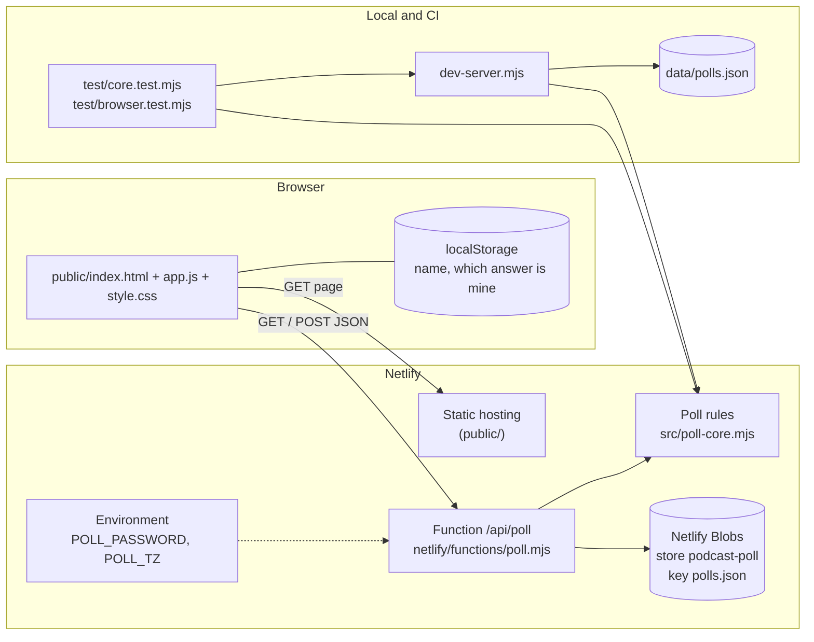

# Architecture

A static page, one serverless function and one JSON document. No framework, no build step for the page, no database.



## Components

- **Page** (`public/`): plain HTML, CSS and JavaScript. Renders the week, the form, the results and the answers; polls the server every 30 seconds and when the tab comes back into view. Keeps the typed name and "which answer is mine" in `localStorage`, never the password.
- **Function** (`netlify/functions/poll.mjs`): a thin wrapper. Reads the body, wraps Netlify Blobs in a `{ read, write }` store with three retries per call, passes `POLL_TZ` and `POLL_PASSWORD` to the core, and turns failures into a 503.
- **Poll rules** (`src/poll-core.mjs`): every rule, with no Netlify imports. Works out "today" and the weeks in the configured time zone, purges ended weeks, validates and applies actions, checks the password, and saves conditionally (etag), re-reading and retrying up to six times on a clash.
- **Local server** (`dev-server.mjs`): serves `public/` and `/api/poll` with the same core and a file store. `FAKE_NOW` fixes the date and `DATA_FILE` moves the data file (both used by the browser test).

## Endpoint: `/api/poll`

- `GET`: returns `{ today, weeks: { this, next }, polls }`.
- `POST` with JSON `{ action, … }`; the answer is the same shape as GET, plus `id` after a vote:
  - `create` `{ week: "this" | "next" }`: creates the poll if missing. No password.
  - `vote` `{ weekStart, id?, name, slots: { "YYYY-MM-DD": ["HH:MM", …] }, password }`: saves or updates an answer.
  - `remove` `{ weekStart, id, password }`: removes an answer.
- Errors: `400` bad input, `403` missing or wrong password (or none configured), `404` poll gone, `405` other methods, `409` repeated save clash, `503` storage did not answer.

## Data

One document, `polls.json`:

```json
{ "polls": { "2026-11-23": { "weekStart": "2026-11-23", "createdAt": "…",
  "responses": { "<uuid>": { "id": "<uuid>", "name": "Ana", "slots": { "2026-11-25": ["19:00"] }, "updatedAt": "…" } } } } }
```

Weeks whose Sunday has passed are removed, and the document saved, the next time anyone loads the page or acts.

## Delivery

- Pull request → **CI** (`.github/workflows/ci.yml`): core tests, script parse check, version check, browser walkthrough.
- Merge to `main` → **Netlify** builds and deploys; the **Tag version** workflow tags `vX.Y.Z` from `VERSION` with the changelog entry.

## Changes

- v0.1: page, function, core and Blobs document.
- v0.2: storage retries in the function and the page.
- v0.3.0: password check in the core; `POLL_PASSWORD` environment variable.
- v0.4.0: CI workflow and `scripts/check-version.mjs`.
- v0.4.1: browser walkthrough in CI; `DATA_FILE` for the local server.
