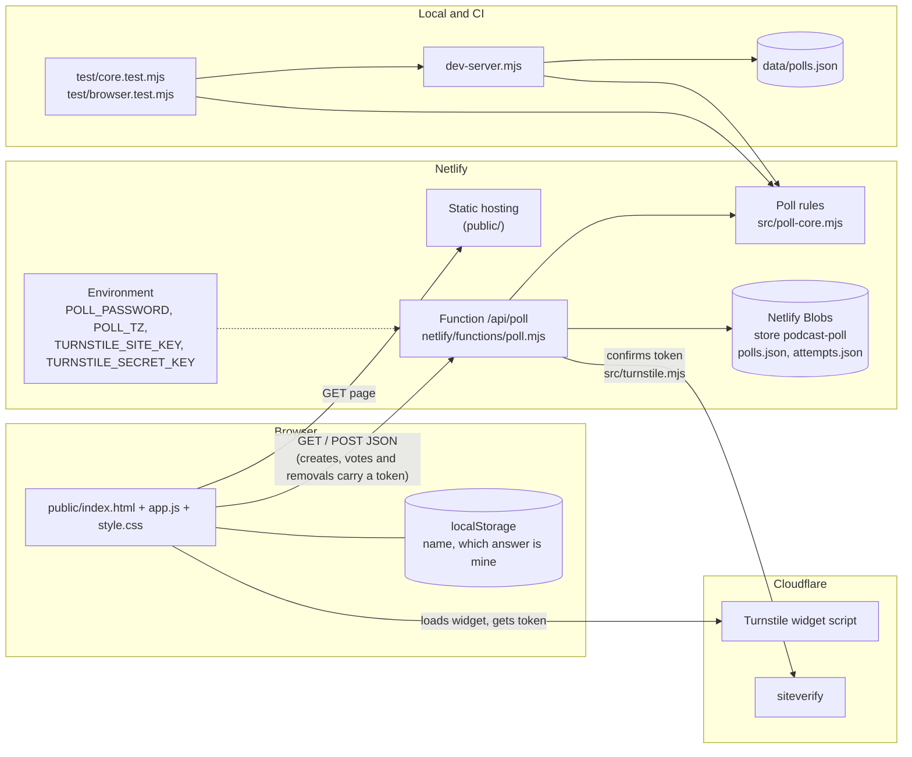

# Architecture

A static page, one serverless function and one JSON document. No framework, no build step for the page, no database.



## Components

- **Page** (`public/`): plain HTML, CSS and JavaScript. Renders the week, the form, the results and the answers; polls the server every 30 seconds and when the tab comes back into view. Keeps the typed name and "which answer is mine" in `localStorage`, never the password. Renders Cloudflare's Turnstile widget (invisible unless a click is needed) with the site key from GET `/api/poll`, sends a fresh token with every create, vote or removal, and resets the widget afterwards.
- **Function** (`netlify/functions/poll.mjs`): a thin wrapper. Reads the body, wraps the two Netlify Blobs documents in `{ read, write }` stores with three retries per call, passes the settings, the Turnstile verifier and the client IP (`context.ip`) to the core, and turns failures into a 503.
- **Human check** (`src/turnstile.mjs`): asks Cloudflare's siteverify whether a token is good, with the secret key and the client IP; fails closed.
- **Poll rules** (`src/poll-core.mjs`): every rule, with no Netlify imports. Works out "today" and the weeks in the configured time zone, purges ended weeks, runs the gate before anything else (creates: human check; votes and removals: timeout, then human check, then password, with wrong passwords counted in the attempts document), validates and applies actions, and saves conditionally (etag), re-reading and retrying up to six times on a clash.
- **Local server** (`dev-server.mjs`): serves `public/` and `/api/poll` with the same core and a file store. `FAKE_NOW` fixes the date and `DATA_FILE` moves the data file (both used by the browser test).

## Endpoint: `/api/poll`

- `GET`: returns `{ today, weeks: { this, next }, polls, siteKey }` (`siteKey` is Turnstile's public site key).
- `POST` with JSON `{ action, … }`; the answer is the same shape as GET, plus `id` after a vote:
  - `create` `{ week: "this" | "next", human }`: creates the poll if missing. Human check only, no password.
  - `vote` `{ weekStart, id?, name, slots: { "YYYY-MM-DD": ["HH:MM", …] }, password, human }`: saves or updates an answer.
  - `remove` `{ weekStart, id, password, human }`: removes an answer.
  - `human` is the Turnstile token. Creates pass the human check first (`403`, or `503` if Cloudflare did not answer). Votes and removals pass the full gate: timeout (`429`), human check (`403`, or `503` if Cloudflare did not answer), password (`403`, or `429` on the third wrong one in a row).
- Errors: `400` bad input, `403` missing or wrong password, failed human check, or either not configured, `404` poll gone, `405` other methods, `409` repeated save clash, `429` timed out after wrong passwords, `503` storage or Cloudflare did not answer.

## Data

One document, `polls.json`:

```json
{ "polls": { "2026-11-23": { "weekStart": "2026-11-23", "createdAt": "…",
  "responses": { "<uuid>": { "id": "<uuid>", "name": "Ana", "slots": { "2026-11-25": ["19:00"] }, "updatedAt": "…" } } } } }
```

A second document, `attempts.json`, holds the wrong-password counts: `{ "clients": { "<hash of IP>": { "fails": 2, "last": "…", "until": "…" } } }`. Entries are tidied away once their count has lapsed and any timeout is over.

Weeks whose Sunday has passed are removed, and the document saved, the next time anyone loads the page or acts.

## Delivery

- Pull request → **CI** (`.github/workflows/ci.yml`): core tests, script parse check, version check, browser walkthrough.
- Merge to `main` → **Netlify** builds and deploys; the **Tag version** workflow tags `vX.Y.Z` from `VERSION` with the changelog entry.

## Changes

- v0.1: page, function, core and Blobs document.
- v0.2: storage retries in the function and the page.
- v0.3.0: password check in the core; `POLL_PASSWORD` environment variable.
- v0.4.0: CI workflow and `scripts/check-version.mjs`.
- v0.4.1: browser walkthrough in CI; `DATA_FILE` for the local server.
- v0.5.0: Cloudflare Turnstile human check (`src/turnstile.mjs`); the gate in the core; `attempts.json` for the wrong-password timeout.
- v0.6.0: the human check also guards `create`; the widget's container moved outside the answer form.
